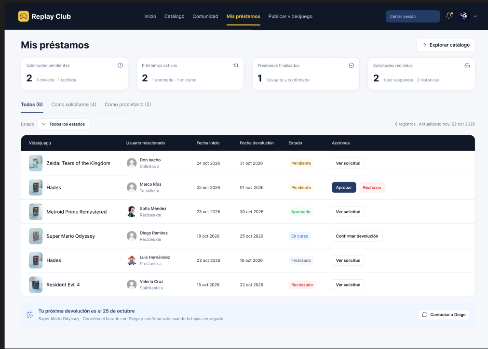

# Consumo de APIs de terceros

Nombres:
- ## Gómez Vasquez Fredy Azarel
- ## Gonzalez Santiago Franscico Javier

## La API que eleguimos para la tabla de datos es la de DummyJSON productos:

- [https://dummyjson.com/products](https://dummyjson.com/products)

## Y para el login se utilizó la API de DummyJSON login:

- [https://dummyjson.com/auth/login](https://dummyjson.com/auth/login)

 

## imagenes del figma 

## React Compiler

Imagenes de la ejecución del proyecto:

## Link del proyecto desplegado en el VPS

If you are developing a production application, we recommend using TypeScript with type-aware lint rules enabled. Check out the [TS template](https://github.com/vitejs/vite/tree/main/packages/create-vite/template-react-ts) for information on how to integrate TypeScript and [`typescript-eslint`](https://typescript-eslint.io) in your project.
