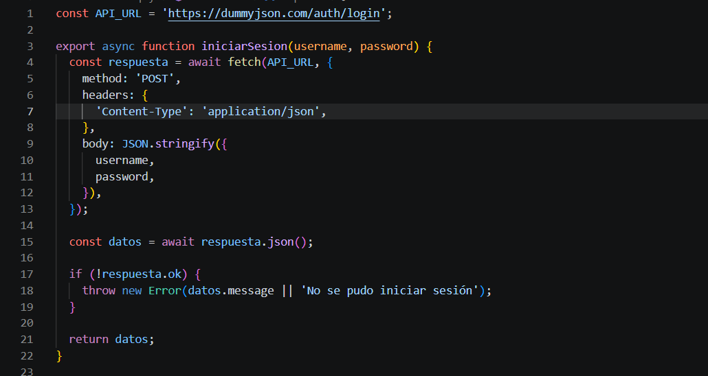
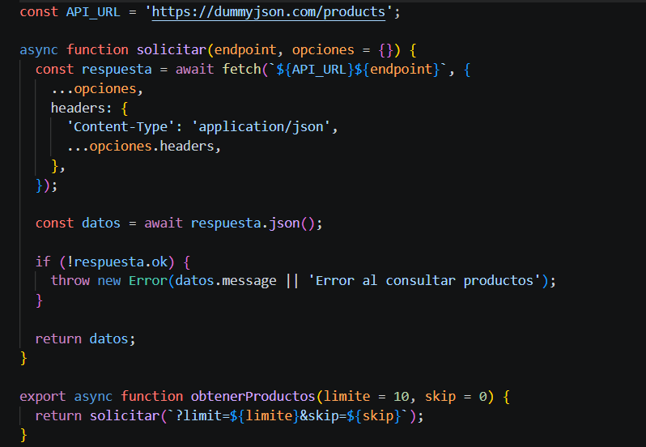
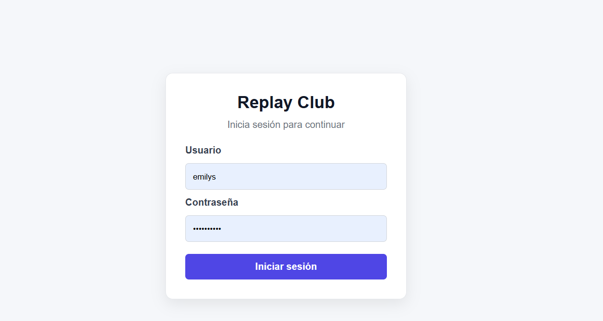
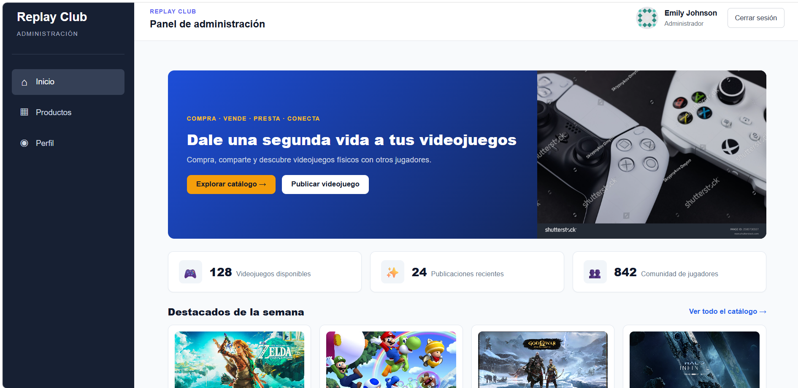
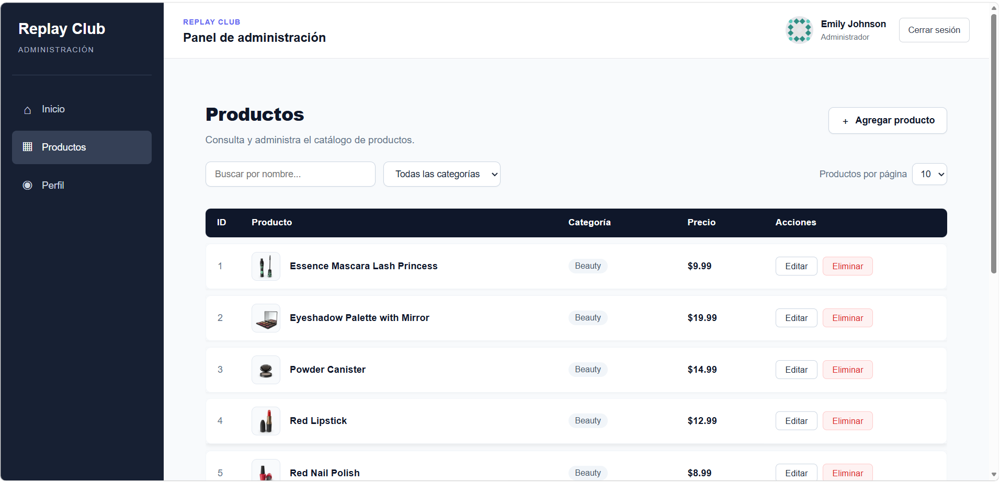

# Consumo de APIs de terceros

Nombres:
- ## Gómez Vasquez Fredy Azarel
- ## Gonzalez Santiago Franscico Javier

La API que eleguimos para la tabla de datos es la de DummyJSON productos

- [https://dummyjson.com/products](https://dummyjson.com/products)

 

## React Compiler

Imagenes de la ejecución del proyecto:

## Link del proyecto desplegado en el VPS

[http://179.197.84.73/t3_act8_eq11/]

---

## Credenciales para entrar con DummyJSON

Usuario: `emilys`
Contraseña: `emilyspass`